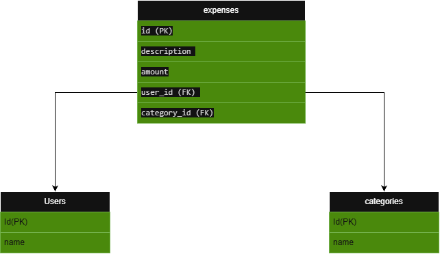

# Expense Management API

A REST API for managing expenses, built with **FastAPI**.

It covers the core parts of a real backend: CRUD endpoints, request/response validation with **Pydantic**, a relational database with **SQLAlchemy** and **Alembic** migrations, **JWT** authentication stored in **HttpOnly cookies**, and **multi-language** responses (English and Persian).

---

## Table of Contents

- [Features](#features)
- [Tech Stack](#tech-stack)
- [Project Structure](#project-structure)
- [Installation](#installation)
- [Running the App](#running-the-app)
- [API Endpoints](#api-endpoints)
- [Validation](#validation)
- [Database](#database)
- [Authentication (JWT + HttpOnly Cookies)](#authentication-jwt--httponly-cookies)
- [Multi-language Support (i18n)](#multi-language-support-i18n)
- [Known Limitations](#known-limitations)

---

## Features

- **CRUD for expenses** — create, list, read, update, and delete
- **Proper HTTP status codes** — `201` on create, `404` when an expense is not found, `401` on auth failures
- **Validation with Pydantic** — separate input (`ExpenseIn`) and output (`ExpenseOut`) models, field constraints, and regex checks
- **Relational database** — SQLite with SQLAlchemy ORM and One-to-Many relationships
- **Database migrations** — managed with Alembic
- **JWT authentication** — short-lived access token and long-lived refresh token, stored in secure HttpOnly cookies
- **Multi-language responses** — English and Persian, detected from a query parameter or the `Accept-Language` header

---

## Tech Stack

| Area | Tool |
|---|---|
| Web framework | FastAPI |
| Server | Uvicorn |
| Validation | Pydantic |
| ORM | SQLAlchemy |
| Migrations | Alembic |
| Database | SQLite |
| JWT | python-jose |
| Password hashing | passlib + bcrypt |
| Translations | gettext + Babel |

---

## Project Structure

```
expense-api/
├── alembic/                  # database migrations
│   └── versions/             # migration files
├── docs/                     # database schema diagram
│   ├── database-schema.drawio
│   └── database-schema.drawio.png
├── locales/                  # translation files
│   ├── en/LC_MESSAGES/       # English (messages.po / messages.mo)
│   └── fa/LC_MESSAGES/       # Persian (messages.po / messages.mo)
├── main.py                   # FastAPI app and all endpoints
├── database.py               # database engine, session, Base
├── models.py                 # SQLAlchemy models (tables)
├── auth.py                   # password hashing and JWT helpers
├── i18n.py                   # translation loading and language detection
├── alembic.ini               # Alembic configuration
└── README.md
```

---

## Installation

**1. Clone the repository**

```bash
git clone https://github.com/hoomanSohrabpoor/expense-api.git
cd expense-api
```

**2. Install dependencies**

```bash
pip install fastapi uvicorn sqlalchemy alembic "python-jose[cryptography]" "passlib[bcrypt]" "bcrypt==4.0.1" babel
```

> `bcrypt` is pinned to `4.0.1` because `passlib 1.7.4` is not compatible with `bcrypt 5.x` (it fails with `password cannot be longer than 72 bytes`).

**3. Create the database**

```bash
alembic upgrade head
```

**4. Compile the translation files**

```bash
python -m babel.messages.frontend compile -d locales -D messages
```

---

## Running the App

```bash
uvicorn main:app --reload
```

If `uvicorn` is not found on Windows, use:

```bash
python -m uvicorn main:app --reload
```

Then open:

- Swagger UI: http://127.0.0.1:8000/docs
- ReDoc: http://127.0.0.1:8000/redoc

---

## API Endpoints

### General

| Method | Endpoint | Description |
|---|---|---|
| GET | `/` | Welcome message (translated) |

### Expenses

| Method | Endpoint | Description | Success |
|---|---|---|---|
| POST | `/expenses` | Create a new expense | `201` |
| GET | `/expenses` | Get all expenses | `200` |
| GET | `/expenses/{id}` | Get one expense by ID | `200` |
| PUT | `/expenses/{id}` | Update an expense | `200` |
| DELETE | `/expenses/{id}` | Delete an expense | `200` |

Requesting an expense that does not exist returns `404`.

### Authentication

| Method | Endpoint | Description |
|---|---|---|
| POST | `/register` | Create a new user |
| POST | `/login` | Check credentials and set auth cookies |
| POST | `/refresh` | Get a new access token using the refresh token |
| POST | `/logout` | Clear the auth cookies |

**Example request body for `POST /expenses`:**

```json
{
  "description": "lunch",
  "amount": 25.5,
  "category": "food"
}
```

**Example response:**

```json
{
  "id": 1,
  "description": "lunch",
  "amount": 25.5,
  "category": "food"
}
```

---

## Validation

Input is validated automatically by Pydantic. Invalid input returns `422` before it reaches the endpoint code.

### Expense (`ExpenseIn`)

| Field | Type | Rule |
|---|---|---|
| `description` | string | Required, 1–100 characters |
| `amount` | float | Must be greater than 0 |
| `category` | string | Letters only — regex `^[a-zA-Z]+$` |

### Register (`UserRegister`)

| Field | Type | Rule |
|---|---|---|
| `name` | string | 1–50 characters |
| `username` | string | 3–30 characters |
| `password` | string | At least 6 characters |

Input and output use **separate models**: the client sends `ExpenseIn` (no `id`), and the API returns `ExpenseOut` (with the generated `id`). `response_model` guarantees the shape of every response.

---

## Database

The schema is documented in the `docs/` folder:

- `docs/database-schema.drawio` — editable diagram (open it at [app.diagrams.net](https://app.diagrams.net))
- `docs/database-schema.drawio.png` — image



### Tables

| Table | Columns |
|---|---|
| `users` | id (PK), name, username (unique), hashed_password |
| `categories` | id (PK), name |
| `expenses` | id (PK), description, amount, user_id (FK → users), category_id (FK → categories) |

### Relationships

- One **user** has many **expenses**
- One **category** has many **expenses**

Both are One-to-Many, defined with `ForeignKey` on the `expenses` table and `relationship(..., back_populates=...)` on both sides.

### Migrations

Whenever `models.py` changes, create and apply a migration:

```bash
alembic revision --autogenerate -m "describe the change"
alembic upgrade head
```

The database file (`expenses.db`) is in `.gitignore` and is not committed. The migration files in `alembic/versions/` **are** committed, because they are the history of the schema.

---

## Authentication (JWT + HttpOnly Cookies)

### Token strategy

| Token | Lifetime | Purpose |
|---|---|---|
| Access token | 15 minutes | Used for normal API access |
| Refresh token | 7 days | Used only to get a new access token |

A short-lived access token limits the damage if it leaks. The refresh token renews the session without asking the user to log in again.

### Flow

```
POST /login     → checks password, sets access + refresh cookies
   ...access token expires after 15 minutes...
POST /refresh   → reads the refresh cookie, sets a new access cookie
POST /logout    → deletes both cookies
```

### Why cookies instead of the Authorization header?

- **XSS protection:** `HttpOnly` cookies cannot be read by JavaScript. A token in `localStorage` sent through the `Authorization` header can be stolen by any injected script.
- **Automatic handling:** the browser sends the cookie itself, so the token never passes through client-side JavaScript.
- **CSRF risk:** because cookies are sent automatically, cross-site request forgery is possible. This is reduced with `SameSite=lax`, and the refresh cookie is limited to the `/refresh` path.

### Cookie security settings

| Setting | Purpose |
|---|---|
| `httponly=True` | JavaScript cannot read the cookie (XSS protection) |
| `secure=True` | Cookie is sent only over HTTPS |
| `samesite="lax"` | Not sent on cross-site requests (CSRF protection) |
| `max_age` | Same as the token lifetime |
| `path="/refresh"` | Refresh token is sent only to the refresh endpoint |

> Because `secure=True` is set, browsers may not store the cookies when running locally over plain `http://`. This is expected; it works over HTTPS in production.

### Security notes

- Passwords are hashed with **bcrypt** and are never stored or returned in plain text.
- Each token has a `type` claim (`access` or `refresh`), so an access token cannot be used to refresh a session.
- Tokens are signed with `HS256`. Any change to a token makes its signature invalid.
- The login error is the same for a wrong username and a wrong password, so an attacker cannot find out which usernames exist.

### Error handling

| Situation | Status | Message |
|---|---|---|
| Username already exists | `400` | `Username already taken` |
| Wrong username or password | `401` | `Invalid username or password` |
| Refresh cookie missing | `401` | `Refresh token missing` |
| Token expired, changed, or wrong type | `401` | `Invalid or expired refresh token` |

---

## Multi-language Support (i18n)

API messages are returned in the user's language. Supported languages: **English (`en`)** and **Persian (`fa`)**.

### How the language is chosen

In this order:

1. The `?lang=` query parameter — the user's explicit choice
2. The `Accept-Language` header — the browser's preference
3. The default language — `en`

```bash
curl "http://127.0.0.1:8000/?lang=fa"
curl -H "Accept-Language: fa-IR,fa;q=0.9" http://127.0.0.1:8000/
```

```json
{"message": "به API مدیریت هزینه خوش آمدید"}
```

If the header lists an unsupported language first (for example `de,fa;q=0.5`), it is skipped and the next supported one is used.

### How it works

- Texts are stored in gettext **`.po`** files (human-readable) and compiled to **`.mo`** files (read by Python).
- `i18n.py` loads all translations **once** at startup.
- `get_language` is a FastAPI dependency that detects the language for each request.
- `get_translator` depends on `get_language` and returns the translation function `_`.
- Endpoints receive it through dependency injection and wrap their messages:

```python
@app.get("/expenses/{expense_id}")
def get_expense(expense_id: int, _=Depends(get_translator)):
    if expense_id not in expenses:
        raise HTTPException(status_code=404, detail=_("Expense not found"))
    return expenses[expense_id]
```

### Adding a new language (example: German `de`)

1. Create the folder `locales/de/LC_MESSAGES/`.
2. Copy `locales/en/LC_MESSAGES/messages.po` into it.
3. Change the header line to `"Language: de\n"` and translate every `msgstr`. **Do not change any `msgid`.**
4. Compile:
   ```bash
   python -m babel.messages.frontend compile -d locales -D messages
   ```
5. Add the language to `i18n.py`:
   ```python
   SUPPORTED_LANGUAGES = ["en", "fa", "de"]
   ```
6. Restart the server.

### Adding a new message

1. Wrap the text in the code: `_("Your new message")`.
2. Add the same `msgid` with its `msgstr` to **every** `.po` file.
3. Compile again with the command above.

### Challenges and important notes

- **Compile after every change.** Python reads the `.mo` file, not the `.po` file. Editing a `.po` file has no effect until it is compiled.
- **`msgid` must match exactly.** A single different character means the translation is not found and the English text is returned.
- **Safe fallback.** With `fallback=True`, a missing translation returns the original English text instead of crashing.
- **UTF-8 is required.** Every `.po` file needs `charset=UTF-8` in its header for Persian characters.
- **Right-to-left text.** Persian is written right to left. Mixed with English words (like `API`), it can look out of order in a raw JSON view. The data is correct; displaying RTL text is the client's job.
- **Load once, not per request.** Reading translation files on every request would be slow.
- **Only user-facing text is translated.** Field names, error codes, and logs stay in English so clients and developers can depend on them.

---

## Known Limitations

This is a learning project. These points are known and are the next steps:

- **Expenses are stored in memory.** The database tables for expenses exist, but the expense endpoints still use an in-memory dictionary, so expenses are lost when the server restarts. Users are stored in the database.
- **Expense endpoints are not protected.** They do not require login yet.
- **The secret key is in the code.** `SECRET_KEY` in `auth.py` must be moved to an environment variable before production.
- **Validation errors are not translated.** Pydantic's automatic `422` messages are always in English. Translating them needs a custom exception handler.
- **No refresh token rotation or revocation.** A stolen refresh token stays valid until it expires.
